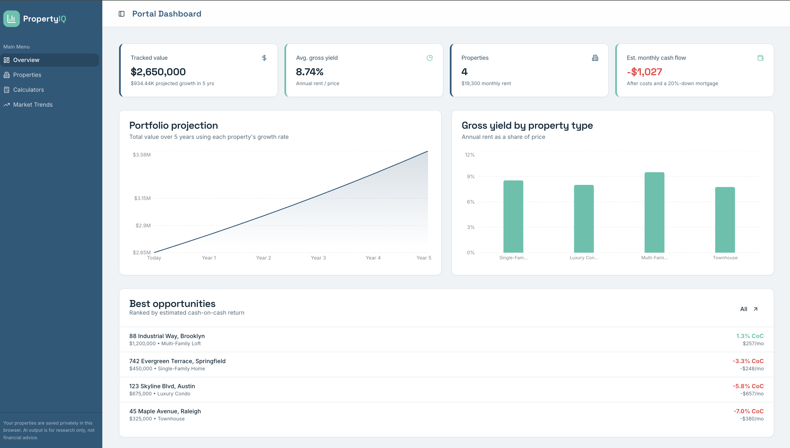
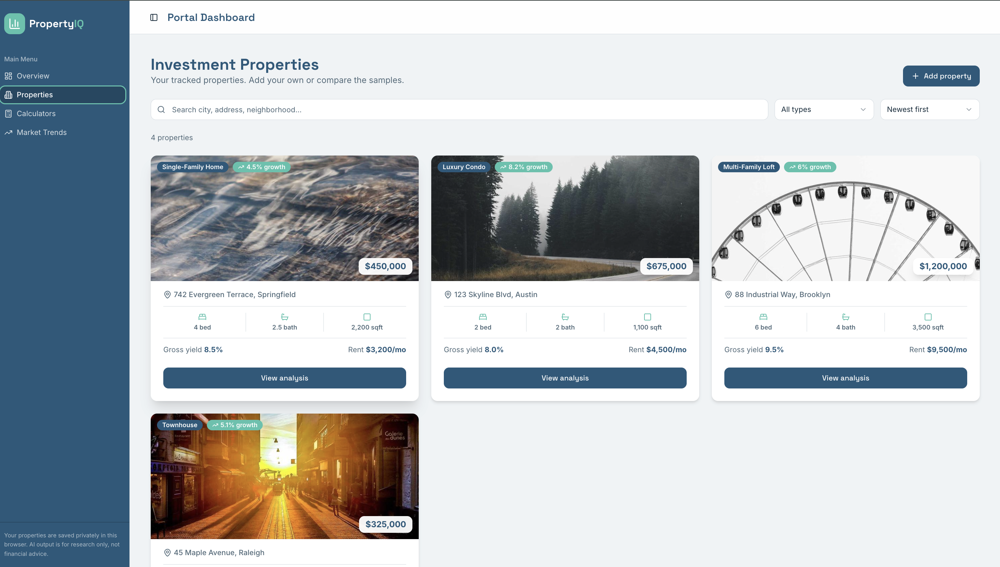
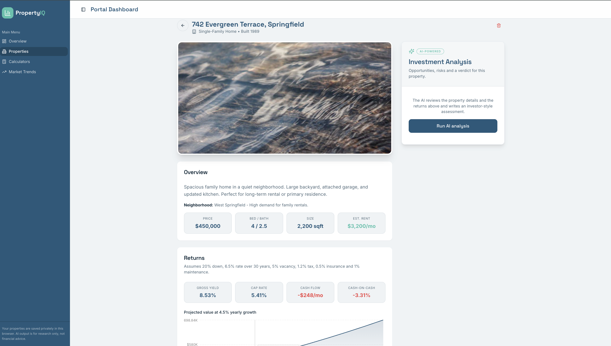
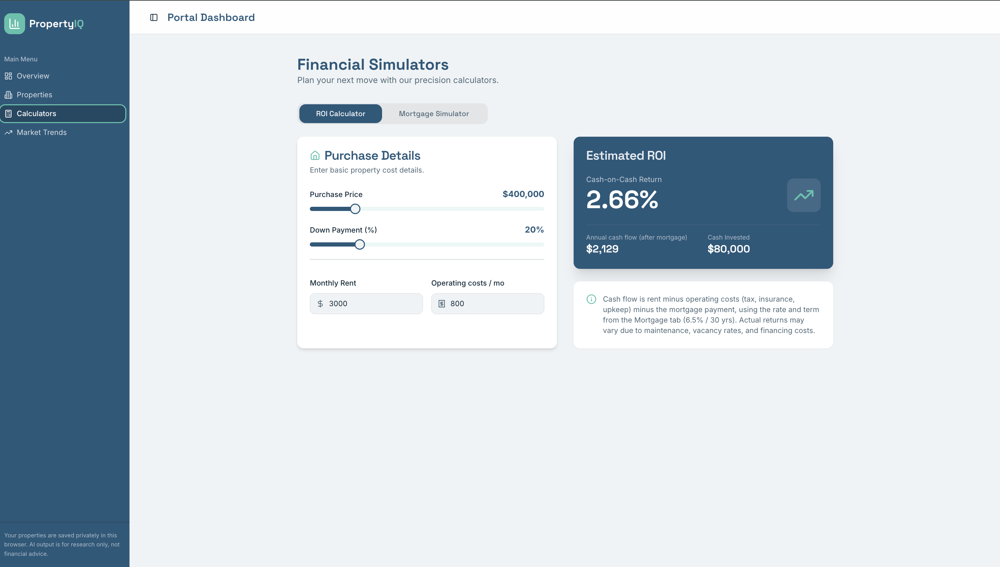
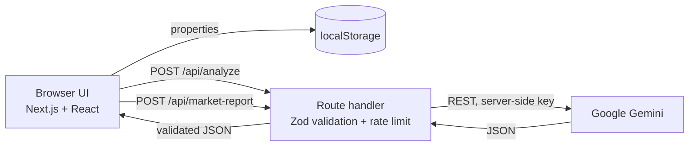

<div align="center">

# PropertyIQ

**Analyze rental properties like an investor. Track deals, see real returns, and get AI-written assessments.**

[](https://nextjs.org/)
[](https://react.dev/)
[](https://www.typescriptlang.org/)
[](https://tailwindcss.com/)
[](https://ai.google.dev/)
[](https://vercel.com/)
[](LICENSE)

</div>

<p align="center">
  
</p>

> **Disclaimer:** PropertyIQ is a research and education tool. AI output and calculators are not financial, tax or legal advice. Verify every figure before investing.

## Overview

PropertyIQ helps an individual investor compare rental properties quickly. Add a property, and the app computes its yield, cap rate and cash flow, projects its value, and asks Gemini for an investor-style assessment. A portfolio dashboard rolls everything up, and built-in calculators let you stress-test financing.

There is no account and no database: your properties are stored privately in your browser, so the app is useful the moment it loads.

## Features

- **Property tracker** - add, search, filter by type, sort by price, yield or growth, and delete.
- **Portfolio dashboard** - tracked value, average gross yield, estimated monthly cash flow, a 5-year projection, yield by property type, and best opportunities ranked by cash-on-cash return.
- **Return metrics** - gross yield, cap rate, monthly cash flow and cash-on-cash for every property, with the assumptions shown in the UI.
- **AI investment analysis** - score out of 100, opportunities, risks, insights and a recommendation.
- **AI market reports** - choose a region, property type and horizon for a structured outlook you can copy.
- **Calculators** - ROI after mortgage, and a mortgage simulator with property tax, insurance and total interest. Open any property in the calculators with its numbers pre-filled.
- **Responsive** - collapsible sidebar on desktop, slide-out menu on phones.

## Screenshots

| Dashboard | Properties |
| --- | --- |
|  |  |

| AI analysis | Calculators |
| --- | --- |
|  |  |

## How it works



- The Gemini API key is read only on the server and never reaches the browser.
- API routes validate input with Zod, limit requests per IP, retry, fall back across Gemini models and discover a working model automatically if one is retired.
- Model answers are validated against a schema before they are shown.

## Tech stack

Next.js 15 (App Router) · React 19 · TypeScript · Tailwind CSS · shadcn/ui · Recharts · Zod · Google Gemini REST API

## Getting started

Requirements: Node.js 20 or newer and a free Gemini API key from https://aistudio.google.com/app/apikey

```bash
git clone https://github.com/Valentina14142000/PropertyIQ.git
cd PropertyIQ
npm install
cp .env.example .env.local
```

Open `.env.local` and set `GEMINI_API_KEY`, then start the app:

```bash
npm run dev
```

Visit http://localhost:9002.

### Environment variables

| Variable | Required | Description |
| --- | --- | --- |
| `GEMINI_API_KEY` | Yes | Google AI Studio key used by the server routes. |
| `GEMINI_MODEL` | No | Pin a model such as `gemini-2.5-flash`. Otherwise the newest flash model is chosen automatically. |

### Scripts

| Command | What it does |
| --- | --- |
| `npm run dev` | Start the development server on port 9002 |
| `npm run build` | Create a production build |
| `npm start` | Run the production build |
| `npm run typecheck` | Type-check the project |

## Deployment (Vercel)

1. Push the repository to GitHub.
2. In Vercel choose **Add New > Project** and import `PropertyIQ`. The Next.js preset is detected automatically.
3. Under **Environment Variables** add `GEMINI_API_KEY` with your key.
4. Click **Deploy**. Every push to `main` redeploys automatically.
5. If visitors are asked to log in to Vercel, open **Settings > Deployment Protection** and turn it off for production.

Never commit `.env` or `.env.local`; they are already in `.gitignore`.

## Calculation assumptions

Per-property metrics use these defaults (see `src/lib/metrics.ts`):

| Assumption | Value |
| --- | --- |
| Down payment | 20% |
| Interest rate / term | 6.5% / 30 years |
| Vacancy | 5% of rent |
| Property tax | 1.2% of price per year |
| Insurance | 0.5% of price per year |
| Maintenance | 1% of price per year |

Gross yield = annual rent / price. Cap rate = net operating income / price. Cash-on-cash = annual cash flow after mortgage / cash invested.

## Project structure

```
src/
  app/
    api/analyze/          AI investment analysis route
    api/market-report/    AI market report route
    dashboard/            Overview, properties, calculators, market pages
  components/             UI, navigation, property form
  lib/                    metrics, storage, Gemini client, rate limiter
```

## Roadmap

- Sign-in and cloud sync across devices
- Editable property details and notes
- Export reports to PDF
- Live listing and rent data sources

## License

Released under the [MIT License](LICENSE).
